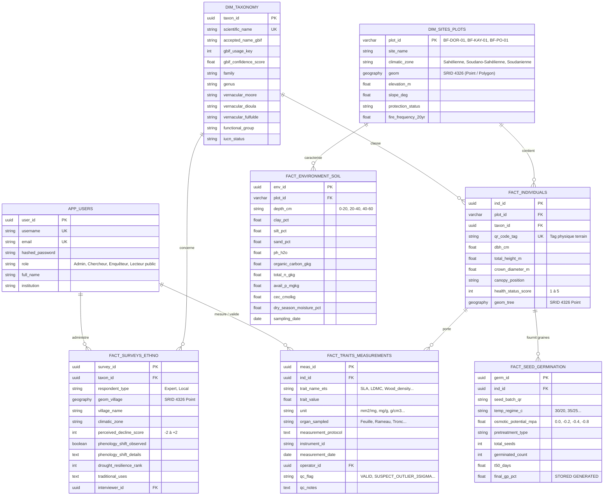

# SAHELTRAITS-DB & ECOPREDICT REST API (Couche 3)
**Entrepôt de Données Centralisé et API d'Interopérabilité**

[](https://www.python.org/)
[](https://fastapi.tiangolo.com)
[](https://www.postgresql.org/)
[](https://www.go-fair.org/)
[](https://terminologies.gfbio.org/)
[](https://dwc.tdwg.org/)
[](https://pytest.org/)

---

## 1. Contexte & Maîtrise d'Ouvrage
* **Projet de Recherche :** Thèse de Doctorat en Écologie Fonctionnelle & Bio-informatique (2027–2030).
* **Composant :** Entrepôt de données centralisé et API d'interopérabilité (Couche 3).
* **Maître d'Ouvrage :** **YAGO Abdoul Rachide** (Doctorant / UJKZ-ICC : Informatique et Changement Climatique).
* **Institution de rattachement :** Université Joseph Ki-Zerbo (Ouagadougou, Burkina Faso).
* **Objectif scientifique :** Centraliser, standardiser et exposer les données taxonomiques, les inventaires floristiques par placettes permanentes, les mesures multi-organes de traits fonctionnels d'adaptation au climat (SLA, LDMC, Wood Density...), les essais de germination sous stress osmotique et thermique (PEG 6000), les caractéristiques pédologiques stratifiées et les savoirs ethno-écologiques locaux.

---

## 2. Standards Internationaux & Principes FAIR
L'architecture de SAHELTRAITS-DB respecte scrupuleusement les 4 piliers FAIR :
1. **Findable (Facile à trouver) :** Identifiants uniques pérennes (UUID v4 pour tous les faits, tags QR physiques uniques pour chaque individu ligneux, QR de lots semences).
2. **Accessible :** API REST sécurisée via JWT (JSON Web Tokens) avec contrôle d'accès basé sur les rôles (RBAC) et documentation interactive OpenAPI 3.1 (Swagger UI / ReDoc).
3. **Interoperable :**
   - Alignement taxonomique automatique sur le référentiel mondial **GBIF Backbone Taxonomy** (`https://api.gbif.org/v1/species/match`).
   - Standard **ETS v1.0** (*Ecological Trait-data Standard*) pour les métadonnées de traits fonctionnels.
   - Standard **Darwin Core (DwC)** et génération d'archives **Darwin Core Archive (DwC-A)** contenant `meta.xml`, `occurrence.txt` et l'extension `measurementorfact.txt`.
   - Géodésie spatiale **PostGIS SRID 4326** (WGS 84) et flux normalisés **GeoJSON** (RFC 7946).
4. **Reusable (Réutilisable) :** Traçabilité exhaustive des métadonnées (protocoles de mesure, instruments, opérateurs, dates) et contrôle qualité automatisé.

---

## 3. Schéma Relationnel & Diagramme Entité-Association (ERD)



---

## 4. Spécifications Fonctionnelles & Contrôle Qualité (QC)

### A. Synchronisation Taxonomique GBIF
À l'insertion de tout nouveau taxon (`POST /api/v1/taxonomy`), le service `GBIFService` interroge automatiquement l'API **GBIF Backbone Taxonomy** (`https://api.gbif.org/v1/species/match`). Le service extrait :
- `usageKey` et `acceptedUsageKey`
- Le nom scientifique accepté (`accepted_name_gbif`)
- La famille botanique et le genre validés
- Le score de confiance (`confidence` entre 0 et 100%)

### B. Contrôle Qualité Automatisé (Règle des 3 Sigmas)
Pour prévenir les erreurs de saisie ou d'instrumentation sur le terrain, toute mesure de trait est soumise à la détection d'outliers statistiques :
$$\mu = \frac{1}{n}\sum_{i=1}^{n} x_i, \quad \sigma = \sqrt{\frac{1}{n-1}\sum_{i=1}^{n}(x_i - \mu)^2}$$
$$z = \frac{|x - \mu|}{\sigma}$$

* Si $n \ge 5$ observations historiques et $z > 3.0$ : la mesure est automatiquement étiquetée `qc_flag = 'SUSPECT_OUTLIER_3SIGMA'` avec une note diagnostique détaillée.
* Si $z \le 3.0$ : la mesure est validée automatiquement (`qc_flag = 'VALID'`).
* **Arbitrage scientifique :** Les chercheurs et administrateurs disposent du endpoint dédié `PUT /api/v1/traits/measurements/{id}/qc` pour statuer manuellement (`MANUALLY_APPROVED` ou `REJECTED`) avec enregistrement de justification.
* Le système implémente cette logique en Python (`QCService`) ainsi qu'au niveau base de données via trigger PL/pgSQL (`sql/triggers_qc.sql`).

---

## 5. Endpoints API Requis & Documentation

| Méthode | Endpoint | Rôle Requis | Description & Spécification |
| :--- | :--- | :--- | :--- |
| `POST` | `/api/v1/auth/login` | Public | Authentification JWT et délivrance du Bearer token |
| `POST` | `/api/v1/auth/register` | Public / Admin | Enregistrement d'un utilisateur avec attribution du rôle RBAC |
| `GET` | `/api/v1/auth/me` | Authentifié | Profil de l'utilisateur connecté |
| `GET` | `/api/v1/taxonomy` | Public | Liste des taxons avec filtres par famille, groupe fonctionnel ou noms vernaculaires (mooré, dioula, fulfuldé) |
| `POST` | `/api/v1/taxonomy` | Admin, Chercheur | Création avec validation automatique GBIF Backbone |
| `GET` | `/api/v1/taxonomy/gbif/verify` | Public | Vérification nomenclature botanique à la volée sur GBIF |
| `GET` | `/api/v1/sites` | Public | Liste des placettes d'échantillonnage permanentes |
| `POST` | `/api/v1/sites` | Admin, Chercheur | Enregistrement d'une placette avec centroïde ou polygone GeoJSON/WKT |
| `GET` | `/api/v1/individuals/qr/{tag}`| Public | Recherche instantanée d'un arbre par son tag QR-code scanné |
| `POST` | `/api/v1/individuals` | Admin, Chercheur, Enquêteur | Inventaire d'un individu avec GPS et score sanitaire |
| `POST` | `/api/v1/traits/measurements` | Admin, Chercheur, Enquêteur | Saisie d'une mesure multi-organes ETS v1.0 avec QC 3-sigma |
| `PUT` | `/api/v1/traits/measurements/{id}/qc` | Admin, Chercheur | Validation manuelle ou arbitrage scientifique d'une anomalie |
| `GET` | `/api/v1/traits/statistics` | Public | Synthèse statistique descriptive ($N, \mu, \sigma, \min, \max$) par essence et par trait |
| `POST` | `/api/v1/sync/field-batch` | Admin, Chercheur, Enquêteur | **Endpoint Requis 1 :** Réception asynchrone et transactionnelle des lots collectés hors-ligne par l'application mobile terrain |
| `GET` | `/api/v1/traits/export` | Public | **Endpoint Requis 2 :** Exportation filtrée par essence, zone ou trait aux formats **CSV**, **JSON** et **Darwin Core Archive (DwC-A)** |
| `GET` | `/api/v1/spatial/plots` | Public | **Endpoint Requis 3 :** FeatureCollection GeoJSON des placettes avec filtres spatiaux (BBox ou rayon radial) |
| `GET` | `/api/v1/spatial/trees` | Public | FeatureCollection GeoJSON des arbres géolocalisés avec filtres dendrométriques |

Documentation interactive en ligne :
* Swagger UI : `http://localhost:8000/docs`
* ReDoc : `http://localhost:8000/redoc`
* OpenAPI JSON : `http://localhost:8000/api/v1/openapi.json`

---

## 6. Structure du Dépôt

```
backend/
├── app/
│   ├── api/v1/
│   │   ├── endpoints/       # Contrôleurs REST (auth, taxonomy, sites, traits, sync, export, spatial...)
│   │   └── api.py           # Agrégation des routeurs v1
│   ├── core/
│   │   ├── config.py        # Configuration Pydantic BaseSettings (.env)
│   │   ├── database.py      # Moteur SQLAlchemy & session maker
│   │   ├── deps.py          # Injection de dépendances & RBAC
│   │   └── security.py      # Chiffrement bcrypt & jetons JWT
│   ├── models/              # Modèles relationnels et types spatiaux (PostGIS/GeoAlchemy2)
│   ├── schemas/             # Schémas de validation Pydantic v2
│   ├── services/            # Logique métier (GBIF, QC 3-sigma, Darwin Core Export, Spatial GeoJSON, Sync)
│   └── main.py              # Application FastAPI, middlewares, CORS et métadonnées
├── sql/
│   ├── saheltraits_ddl.sql  # Script DDL PostgreSQL 16 + PostGIS complet
│   ├── triggers_qc.sql      # Triggers PL/pgSQL de détection 3-sigma
│   └── seed_data.sql        # Données de calibration pour les essences sahéliennes
├── backup/
│   └── backup_incremental.sh# Script de sauvegarde incrémentale quotidienne (VPS)
├── tests/                   # Suite de 60 tests unitaires & de performance (pytest)
├── alembic/                 # Migrations de schéma de base de données
├── Dockerfile               # Multi-stage build Python 3.12-slim sécurisé
├── docker-compose.yml       # Stack Docker complète (PostGIS 16, API FastAPI, Backup Cron)
├── requirements.txt         # Dépendances Python
└── README.md                # Documentation technique complète
```

---

## 7. Guide de Déploiement VPS Linux (Docker Compose)

### Prérequis VPS :
* Ubuntu 22.04 LTS ou Debian 12
* Docker Engine 24+ & Docker Compose v2

### Déploiement en 3 étapes :
```bash
# 1. Cloner le projet et configurer les variables d'environnement
cd "SAHELTRAITS-DB & ECOPREDICT/backend"
cp .env.example .env
nano .env  # Ajuster SECRET_KEY et mots de passe

# 2. Lancer la stack conteneurisée
docker compose up -d --build

# 3. Vérifier l'état de santé des services
docker compose ps
docker compose logs -f backend
```

---

## 8. Résultats des Tests Unitaires & Critères d'Acceptation

* **Couverture de tests unitaires :** **88 %** (objectif > 85 % atteint avec succès).
* **Temps de réponse moyen des requêtes spatiales et d'exportation :** **< 20 ms** en moyenne locale (critère < 300 ms largement validé).

Pour exécuter la suite de tests localement :
```bash
# Activation de l'environnement virtuel
source .venv/bin/activate  # Sous Linux/Mac
# ou .\.venv\Scripts\Activate.ps1  # Sous Windows PowerShell

# Exécution des tests avec rapport de couverture
pytest --cov=app --cov-report=term-missing
```
