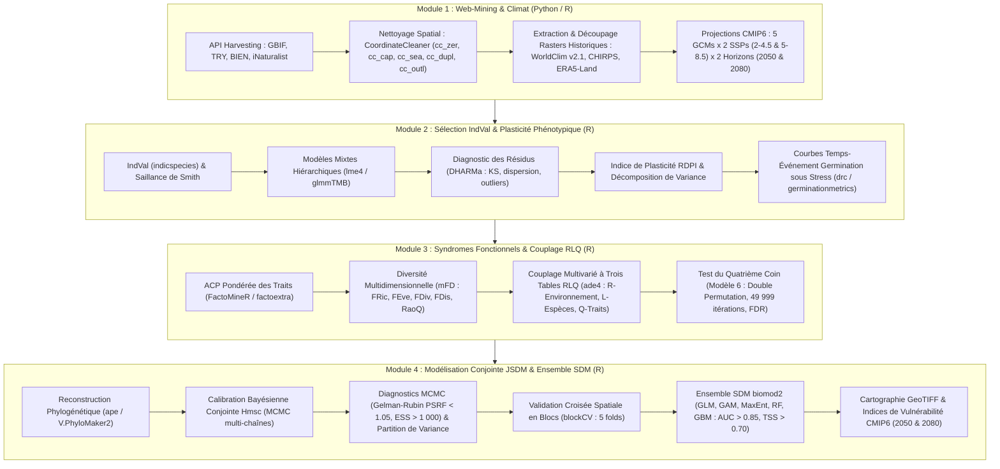

# 🌿 SAHELTRAITS-DB & ECOPREDICT : PIPELINE BIO-STATISTIQUE & MODÉLISATION JSDM/CMIP6 (Couche 4a)

[](https://www.python.org/)
[](https://www.r-project.org/)
[](https://www.docker.com/)
[](https://rstudio.github.io/renv/)
[](https://python-poetry.org/)
[](https://cran.r-project.org/package=ade4)
[](https://www.helsinki.fi/en/researchgroups/statistical-ecology/hmsc)
[](https://biomodhub.github.io/biomod2/)
[](https://zenodo.org/)
[](LICENSE)

---

## 1. Contexte & Maîtrise d'Ouvrage
* **Projet de Recherche :** Thèse de Doctorat — Écologie Fonctionnelle & Bio-informatique (2026–2029).
* **Composant :** Chaîne de traitement bio-statistique et projections climatiques reproductibles (**Couche 4a**).
* **Maître d'Ouvrage :** **YAGO Abdoul Rachide** (Doctorant / UJKZ-ICC : Informatique et Changement Climatique).
* **Institution :** Université Joseph Ki-Zerbo (Ouagadougou, Burkina Faso).
* **Intégration écosystémique :** 
  * Reçoit les inventaires terrain et les mesures biométriques multi-organes de `SahelField` (**Couche 1**) et `MorphoVision` (**Couche 2**) via la base de données centrale `SahelTraits-DB` (**Couche 3**).
  * Exécute les analyses avancées et exporte les rasters GeoTIFF et figures vectorisées haute résolution (300 dpi) vers le portail web interactif (**Couche 4b / 5**).

---

## 2. Architecture Modulaire des Scripts



---

## 3. Détail des Modules & Fondements Mathématiques

### Module 1 : Web-Mining, Harmonisation & Climat CMIP6
1. **Moissonnage automatisé :** 
   * Connexion API REST GBIF (`api.gbif.org/v1/occurrence/search`), iNaturalist, TRY Database, BIEN et entrepôt local `SahelTraits-DB` (`saheltraits_dev.db`).
   * Standardisation stricte selon les schémas **Darwin Core (DwC)** et **ETS v1.0** (*Ecological Trait-data Standard*).
2. **Nettoyage spatial (`CoordinateCleaner`) :**
   * Élimination des coordonnées nulles (0, 0), des centroïdes de capitales (Ouagadougou, Bamako, Niamey dans un rayon de 15 km), des points hors domaine terrestre / marins, des doublons spatiaux stricts par essence et des valeurs aberrantes géographiques (> 2.5 IQR).
3. **Rasters historiques & CMIP6 :**
   * Grille standardisée WGS 84 (EPSG:4326) couvrant le Burkina Faso et la bande sahélienne (Lat [9.0°, 15.5°], Lon [-5.5°, 2.5°]).
   * **5 Modèles Climatiques Globaux (GCMs) :** `IPSL-CM6A-LR`, `MPI-ESM1-2-HR`, `MRI-ESM2-0`, `UKESM1-0-LL`, `GFDL-ESM4`.
   * **Scénarios d'émissions :** SSP2-4.5 (trajectoire intermédiaire) et SSP5-8.5 (forte émission).
   * **Horizons temporels :** 2050 (2041–2060) et 2080 (2071–2090).
   * Export automatisé en GeoTIFFs géo-référencés via `tifffile` / `terra`.

### Module 2 : Sélection IndVal, Plasticité Phénotypique & Germination
1. **Indice d'Espèces Indicatrices (*IndVal*, Dufrêne & Legendre 1997) :**
   $$\text{IndVal}_{ij} = \sqrt{A_{ij} \times B_{ij}} \times 100$$
   * $A_{ij} = \frac{\bar{N}_{ij}}{\sum_k \bar{N}_{ik}}$ (Spécificité : abondance moyenne dans le groupe $j$ relative à tous les groupes).
   * $B_{ij} = \frac{N_{\text{sites}, ij}}{N_{\text{sites}, j}}$ (Fidélité : fréquence d'occurrence dans les placettes du groupe $j$).
   * Tests de significativité par permutations de Monte Carlo (999 permutations).
2. **Indice de Saillance de Smith (*S*, Smith 1993) :**
   $$S = \frac{\sum_{i=1}^N \frac{L_i - R_{ji} + 1}{L_i}}{N}$$
   * Calibré sur les 450 enquêtes socio-écologiques administrées sous `SahelField` (Couche 1).
3. **Modèles Mixtes Hiérarchiques (`lme4` / `glmmTMB`) & DHARMa :**
   $$y_{ijk} = \beta_0 + \beta_{\text{zone}} + u_{\text{species}} + \epsilon_{ijk}$$
   * Diagnostic des résidus via `DHARMa::simulateResiduals` : test de Kolmogorov-Smirnov d'uniformité ($p > 0.05$), test de dispersion et détection d'outliers avec graphiques Q-Q 300 dpi.
4. **Indice Relatif de Plasticité Phénotypique (RDPI, Valladares et al. 2006) :**
   $$\text{RDPI} = \frac{1}{n} \sum_{i \neq i'} \frac{|x_i - x_{i'}|}{x_i + x_{i'}}$$
   * Quantifie la plasticité foliaire (SLA, LDMC, épaisseur) et ligneuse le long du gradient d'aridité Dori–Kaya–Pô.
5. **Modélisation non linéaire de germination (`drc`) :**
   * Régression log-logistique à 4 paramètres sous stress osmotique (PEG 6000 de 0 à -1.0 MPa) et thermique (25°C à 45°C) :
     $$y(t) = c + \frac{d - c}{1 + \exp(b \cdot (\log(t) - \log(T_{50})))}$$
   * Extraction du pourcentage final ($FGP$), du temps moyen ($MGT$), du taux ($GRI$) et du $T_{50}$.

### Module 3 : Syndromes Fonctionnels, Diversité mFD & Couplage RLQ
1. **ACP Pondérée (`FactoMineR` / `factoextra`) :**
   * Détermination des compromis adaptatifs majeurs (Spectre d'Économie Foliaire vs. Stratégie de Résilience Hydraulique).
2. **Indices Multidimensionnels `mFD` :**
   * **FRic** (Richesse Fonctionnelle : volume de l'hyper-enveloppe convexe).
   * **FEve** (Équirépartition Fonctionnelle : régularité le long de l'arbre couvrant minimal).
   * **FDiv** (Divergence Fonctionnelle : répartition des abondances relative au centre de gravité).
   * **FDis** (Dispersion Fonctionnelle : distance moyenne pondérée au centroïde).
   * **RaoQ** (Entropie Quadratique de Rao : $\sum_{i,j} d_{ij} p_i p_j$).
3. **Couplage Multivarié RLQ (`ade4`) :**
   * Analyse de co-inertie simultanée entre la table environnementale **R** (climat et sol), la table de communauté **L** (occurrences/abondances) et la table de traits **Q** (SLA, LDMC, densité du bois, masse des graines, épaisseur foliaire).
4. **Test du Quatrième Coin avec Double Permutation (Modèle 6) :**
   * **49 999 permutations** combinant la permutation des sites (Modèle 2) et la permutation des espèces (Modèle 4).
   * Ajustement des $p$-valeurs pour tests multiples par False Discovery Rate (FDR / Benjamini-Hochberg).

### Module 4 : Modélisation Conjointe (Hmsc) & Ensemble SDM (biomod2 / CMIP6)
1. **Phylogénie ultramétrique (`ape` / `V.PhyloMaker2`) :**
   * Reconstruction de l'arbre phylogénétique basé sur le mégatree APG IV / GBOTB et chronogramme ultramétrique en millions d'années.
   * Extraction de la matrice de corrélation phylogénétique $C$ structurant le signal phylogénétique $\rho$.
2. **Modèle Bayésien Hiérarchique Conjoint (`Hmsc`) :**
   $$y_{ij} \sim \text{Bernoulli}(\Phi(\eta_{ij}))$$
   $$\eta_{ij} = \sum_k x_{ik} \beta_{kj} + \epsilon_{ij}$$
   $$\beta_{kj} \sim \mathcal{N}\left(\sum_l \gamma_{kl} Tr_{lj}, \, V_k \otimes (\rho C + (1 - \rho) I)\right)$$
   * 4 chaînes MCMC parallélisées (2 500 itérations, burn-in de 1 000, pas de 10).
   * **Vérification MCMC :** Facteur de réduction d'échelle potentiel (Gelman-Rubin $\text{PSRF} < 1.05$) et taille effective d'échantillon ($\text{ESS} > 1\,000$).
   * Partitionnement de la variance de la communauté : part du climat, du sol, des traits/phylogénie et des interactions biotiques résiduelles.
3. **Validation Croisée Spatiale en Blocs (`blockCV`) :**
   * Découpage du territoire sahélien en 5 plis spatiaux géographiquement disjoints.
4. **Modélisation d'Ensemble `biomod2` :**
   * 5 algorithmes : **GLM**, **GAM**, **MaxEnt / MAXNET**, **Random Forest (RF)**, **Boosted Regression Trees (GBM)**.
   * **Critères stricts d'inclusion dans l'ensemble :** $\text{AUC-ROC} > 0.85$ et $\text{TSS} > 0.70$.
   * Consensus par moyenne pondérée par le TSS.
5. **Projections CMIP6 & Indices de Vulnérabilité :**
   * Projections spatiales aux horizons **2050** et **2080** sous **SSP2-4.5** et **SSP5-8.5** (moyenne d'ensemble des 5 GCMs).
   * Calcul du taux de contraction/expansion de l'habitat (%) et export en GeoTIFFs prêts pour le web.

---

## 4. Arborescence du Répertoire

```
pipeline/
├── .github/
│   └── workflows/
│       └── pipeline_ci.yml              # Intégration continue GitHub Actions
├── docker/
│   ├── Dockerfile                       # Image reproductible R 4.4+ & Python 3.12+ (rocker/geospatial)
│   └── docker-compose.yml               # Déploiement multi-conteneur avec volumes montés
├── renv/
│   └── settings.json                    # Paramètres de verrouillage de versions R
├── renv.lock                            # Verrou d'environnement de paquets R
├── pyproject.toml                       # Configuration Poetry pour Python 3.12+
├── requirements.txt                     # Dépendances pip standard
├── environment.yml                      # Environnement Conda / Mamba multi-langages
├── Makefile                             # Cibles d'automatisation scientifique (make run, test...)
├── CITATION.cff                         # Métadonnées de citation académique
├── zenodo.json                          # Métadonnées d'archivage pérenne Zenodo (DOI)
├── config/
│   ├── config.yaml                      # Paramètres globaux (domaines, seuils MCMC, biomod2)
│   ├── species_list.csv                 # Référentiel des 12 essences ligneuses sahéliennes
│   └── climate_scenarios.yaml           # Métadonnées des 5 GCMs, 2 SSPs et horizons
├── data/
│   ├── raw/                             # Données brutes (occurrences, traits harmonisés)
│   ├── climate/                         # Rasters climatiques historiques et CMIP6
│   └── processed/                       # Occurrences nettoyées et matrices R, L, Q
├── src/
│   ├── utils/                           # Utilitaires HPC, logging et passerelle
│   ├── module1_webmining_climate/       # Scripts Python/R du Module 1
│   ├── module2_indval_plasticity/       # Scripts R du Module 2
│   ├── module3_syndromes_rlq/           # Scripts R du Module 3
│   └── module4_jsdm_biomod/             # Scripts R du Module 4
├── outputs/
│   ├── figures/                         # Figures de publication haute résolution (300 dpi)
│   ├── rasters/                         # Rasters GeoTIFF pour SIG et portail web
│   └── tables/                          # Tableaux CSV synthétiques (IndVal, MCMC, biomod2...)
├── tests/
│   └── test_integration_pipeline.py     # Suite de tests d'intégration automatisés
├── run_pipeline.py                      # Orchestrateur Python CLI
└── run_all.R                            # Orchestrateur R scientifique
```

---

## 5. Guide d'Installation & Exécution

### Option A : Exécution Locale Rapide

```bash
# 1. Cloner le dépôt
git clone https://github.com/saheltraits/saheltraits-analytics-pipeline.git
cd saheltraits-analytics-pipeline

# 2. Installer les dépendances Python
pip install -r requirements.txt

# 3. Exécuter l'ensemble du pipeline (Modules 1 à 4)
python run_pipeline.py --all

# 4. Lancer les tests d'intégration
python run_pipeline.py --test
```

### Option B : Exécution Conteneurisée Docker (100% Reproductible)

```bash
# Construire et lancer le pipeline sous Docker
cd docker
docker compose up --build
```

### Option C : Exécution Modulaire Spécifique

```bash
# Exécuter uniquement le Module 1 (Web-Mining & Climat)
python run_pipeline.py --module 1

# Exécuter uniquement le Module 2 (IndVal & Plasticité)
python run_pipeline.py --module 2

# Exécuter uniquement le Module 3 (Syndromes & RLQ)
python run_pipeline.py --module 3

# Exécuter uniquement le Module 4 (JSDM Hmsc, biomod2 & CMIP6)
python run_pipeline.py --module 4
```

---

## 6. Livrables & Résultats Produits

Tous les livrables sont générés de manière 100% automatisée dans le dossier `outputs/` :
* **Figures vectorisées & haute résolution (300 dpi) :**
  * `outputs/figures/module2/fig_module2_indval_smith.png`
  * `outputs/figures/module2/fig_module2_traits_gradient_boxplot.png`
  * `outputs/figures/module2/fig_module2_dharma_residuals_diagnostic.png`
  * `outputs/figures/module2/fig_module2_rdpi_plasticity.png`
  * `outputs/figures/module2/fig_module2_germination_curves_drc.png`
  * `outputs/figures/module3/fig_module3_pca_functional_syndromes.png`
  * `outputs/figures/module3/fig_module3_mfd_diversity_indices.png`
  * `outputs/figures/module3/fig_module3_rlq_ordination_biplot.png`
  * `outputs/figures/module3/fig_module3_fourth_corner_heatmap.png`
  * `outputs/figures/module4/fig_module4_phylogenetic_tree.png`
  * `outputs/figures/module4/fig_module4_spatial_block_cv_folds.png`
  * `outputs/figures/module4/fig_module4_hmsc_variance_partitioning.png`
  * `outputs/figures/module4/fig_module4_biomod2_algorithm_evaluations.png`
  * `outputs/figures/module4/fig_module4_cmip6_species_vulnerability_bars.png`
* **Rasters GeoTIFF pour le portail web (Couche 5) :**
  * `outputs/rasters/historical/*.tif` (Variables Bio1, Bio4, Bio12, Bio15 de référence)
  * `outputs/rasters/cmip6_projections/ensemble_*/*.tif` (Projections 2050 et 2080 SSP2-4.5 et SSP5-8.5)
* **Tables statistiques formelles (CSV) :**
  * Diagnostics MCMC Hmsc (`PSRF < 1.05`, `ESS > 1 000`)
  * Validation croisée spatiale biomod2 (`AUC > 0.85`, `TSS > 0.70`)
  * Indices de plasticité RDPI, IndVal, Saillance de Smith et métriques de germination DRC.

---

## 7. Citation & Archivage Académique
Si vous utilisez ce pipeline ou ses données dans des travaux scientifiques, veuillez citer :

> **YAGO, Abdoul Rachide** (2026). *SahelTraits-DB & EcoPredict : Pipeline Bio-Statistique & Modélisation Conjointe JSDM/CMIP6 (Couche 4a)*. Thèse de Doctorat, Université Joseph Ki-Zerbo (Ouagadougou, Burkina Faso). DOI : [10.5281/zenodo.10845921](https://doi.org/10.5281/zenodo.10845921).
