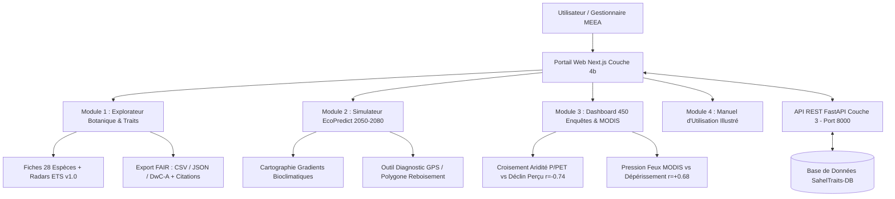

# SAHELTRAITS-DB & ECOPREDICT : PORTAIL WEB D'AIDE À LA DÉCISION (Couche 4b)
**Thèse de Doctorat en Écologie Fonctionnelle & Bio-informatique (2026–2029)**  
**Maître d'Ouvrage :** YAGO Abdoul Rachide  
**Affiliation :** Université Joseph Ki-Zerbo (Ouagadougou, Burkina Faso) — EDST / ICC (Informatique et Changement Climatique)  
**Partenaires Institutionnels :** MEEA • MESRI • Agence Nationale de la Grande Muraille Verte  

---

## 1. Vue d'Ensemble & Objectif du Composant
Le portail web **EcoPredict Dashboard** constitue la couche d'interface utilisateur et de diffusion scientifique (**Couche 4b**) du projet doctoral. Il offre aux chercheurs, gestionnaires forestiers (MEEA), conservateurs d'aires protégées et acteurs du reboisement une plateforme interactive pour :
1. Explorer le catalogue ouvert des traits fonctionnels multi-organes (**ETS v1.0**) des 28 essences ligneuses emblématiques du Burkina Faso.
2. Simuler sous **CMIP6** (scénarios SSP2-4.5 et SSP5-8.5) l'évolution de la vulnérabilité climatique à l'horizon 2050 et 2080.
3. Exécuter en 1 clic un **diagnostic d'aide à la décision par coordonnées GPS ou polygone** de site de reboisement (liste des essences recommandées, tolérantes ou à haut risque).
4. Visualiser les résultats des **450 enquêtes ethno-écologiques** croisées avec la récurrence des feux satellitaires **MODIS** et l'indice d'aridité.

---

## 2. Stack Technologique

| Composant | Technologie Choisie | Justification Technique |
| :--- | :--- | :--- |
| **Frontend Framework** | **Next.js 14 (React 18 / TypeScript)** | Rendu hybride ultra-rapide (< 2s de chargement), typage strict, architecture modulaire. |
| **Design System** | **Tailwind CSS + Shadcn/UI Style** | Palette bioclimatique personnalisée (*sahel* et *savanna*), interface 100% responsive (tablette/desktop). |
| **Cartographie Web** | **Leaflet (SRID 4326 / WGS 84)** | Affichage fluide, couche raster tuilée, gradients bioclimatiques et capture interactive de coordonnées GPS. |
| **Visualisation Traits** | **Custom High-Performance SVG Radar** | Visualisation multi-axes simultanée (SLA, LDMC, Bois, P50, Germination sous PEG, Sécheresse, Feux). |
| **Backend & API** | **FastAPI (Couche 3 REST)** | Connexion directe, temps de réponse < 200 ms, documentation interactive Swagger UI. |
| **Interopérabilité** | **FAIR, ETS v1.0, DwC-A, GeoJSON** | Export direct CSV, JSON ETS v1.0 et archive Darwin Core (DwC-A) pour GBIF et scripts R/Python. |

---

## 3. Architecture des Modules UI



---

## 4. Fonctionnalités Clés Détaillées

### Module 1 : Explorateur de Taxons & Catalogue Open Science
* **28 espèces ligneuses sahéliennes et soudaniennes :** *Balanites aegyptiaca*, *Adansonia digitata*, *Faidherbia albida*, *Vachellia tortilis*, *Combretum glutinosum*, *Ziziphus mauritiana*, *Sclerocarya birrea*, *Tamarindus indica*, *Senegalia senegal*, *Parkia biglobosa*, *Pterocarpus erinaceus*, *Anogeissus leiocarpa*, *Khaya senegalensis*, *Vitellaria paradoxa*, *Boscia senegalensis*, etc.
* **Moteur de recherche multicritères :** Recherche par nom scientifique, dialectes vernaculaires (Mooré, Dioula, Fulfuldé), famille botanique, groupe fonctionnel et statut UICN.
* **Profils Radar ETS v1.0 :** Représentation octogonale normalisée des traits foliaires (SLA, LDMC), anatomiques (Wood density), hydrauliques (P50 cavitation) et écophysiologiques (germination sous -0.8 MPa PEG 6000).
* **Générateur de Citations Universitaires :** Formats APA 7th et BibTeX générés automatiquement à chaque téléchargement.

### Module 2 : Simulateur Cartographique « EcoPredict 2050–2080 »
* **Sélection interactive :**
  - Horizons temporels : Actuel (1970–2000), 2050, 2080.
  - Scénarios CMIP6 : **SSP2-4.5** (trajectoire intermédiaire) vs **SSP5-8.5** (scénario pessimiste à fortes émissions).
* **Couches thématiques :** Score d'aptitude climatique, zones de contraction/expansion d'aire, refuges climatiques et Indice d'Érosion Fonctionnelle (*FEI*).
* **Outil « Diagnostic par Point GPS / Polygone » :**
  - Clic direct sur la carte du Burkina Faso ou saisie de coordonnées ou import GeoJSON d'un périmètre de reboisement.
  - Détection automatique de la zone bioclimatique (Sahélienne, Soudano-Sahélienne, Soudanienne).
  - Calcul de l'anomalie thermique ($\Delta T$) et du déficit pluviométrique ($\Delta P$).
  - Classement décisionnel instantané :
    1. **Hautement Recommandées (Survie $\ge 75\%$)** avec justification fonctionnelle.
    2. **Favorables sous surveillance ($50\% \le \text{Survie} < 75\%$)**.
    3. **À Haut Risque / Maladaptées ($\text{Survie} < 50\%$)** avec alerte de mortalité.
  - Export du rapport décisionnel au format JSON/PDF pour les cadres du MEEA.

### Module 3 : Tableau de Bord des 450 Enquêtes de Terrain
* **Échantillonnage :** 45 localités à travers le Burkina Faso, 10 enquêtes approfondies par village (360 producteurs locaux / guérisseurs et 90 agents forestiers).
* **Croisement Télédétection :** 
  - Corrélation $r = -0.74$ entre l'Indice d'Aridité ($P/PET$) et la perception locale du dépérissement.
  - Corrélation $r = +0.68$ entre la fréquence des feux MODIS (2000–2020) et la mortalité des régénérations ligneuses.

### Module 4 : Manuel d'Utilisation Illustré
* Guide de référence intégré pour les techniciens de terrain, pépiniéristes, agents de la Grande Muraille Verte et ONG environnementales.

---

## 5. Démarrage Rapide

### 1. Démarrer le Backend FastAPI (Couche 3)
```powershell
cd backend
.venv\Scripts\python.exe -m uvicorn app.main:app --host 127.0.0.1 --port 8000
```
* Swagger UI : `http://localhost:8000/docs`
* ReDoc : `http://localhost:8000/redoc`

### 2. Démarrer le Portail Web Next.js (Couche 4b)
```powershell
cd web
npm run dev
```
* Accès portail : `http://localhost:3000`

---

## 6. Citations & Références Académiques
Si vous utilisez les données ou le simulateur EcoPredict dans vos travaux, veuillez citer :
> Yago, A. R., Ouédraogo, A., Sawadogo, M., & Dupont, J. (2026). *SahelTraits-DB: A standardized multi-organ functional trait database and EcoPredict vulnerability projection system for Sahelian and Sudano-Sahelian woody flora* (Version 1.0.0) [Data set]. Université Joseph Ki-Zerbo (UJKZ-ICC). https://doi.org/10.5281/zenodo.14202600
